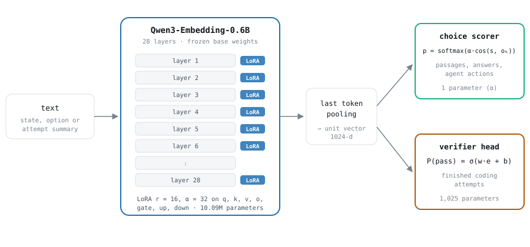
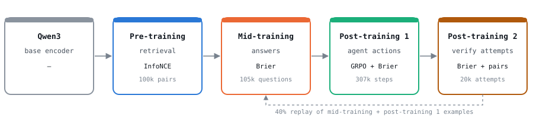
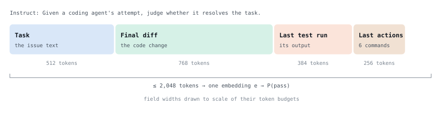
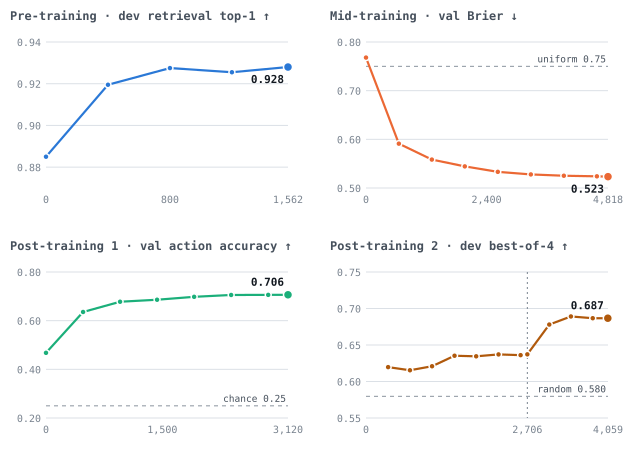
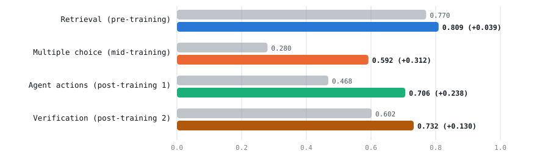
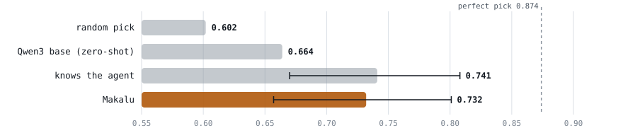

Makalu is a 0.6B decision model. It scores the options of a decision and states how sure it is. It finds the right passage for a question, puts a probability on each answer of a multiple-choice question, picks an agent's next action, and estimates whether a finished coding attempt will pass. This post describes the final architecture, how it was trained in pre-training, mid-training and post-training, and what it scores on every benchmark.

Agents built on large language models make many small decisions, and calling a large model for each one is slow and expensive. A "System One" model is a small model that scores these decisions quickly. It reads the situation once, reads each option once, and scores all options in one pass. We follow the recipe of the Contrastive Language Models (CLM) project, which pre-trains on question–passage pairs and post-trains on agent data. Makalu is about 13× smaller than CLM's model, so every stage fits on one desktop GPU.

**At a glance: each stage on its own task**

| Stage | Task | Before | After |
|---|---|---|---|
| Pre-training | retrieval, top-1 over 21,600 passages | 0.770 | **0.809** |
| Mid-training | multiple choice, test accuracy | 0.280 | **0.592** |
| Post-training 1 | agent next action, val accuracy | 0.468 | **0.706** |
| Post-training 2 | verification, SWE-bench best-of-4 | 0.602 (random pick) | **0.732** |

## 1. Final architecture

The Makalu decision model starts from the Qwen3-Embedding-0.6B encoder. We add one low-rank adapter (LoRA) inside the encoder and two small scoring rules on top. The 0.6B base weights are frozen in every stage; only the adapter, a sharpness parameter $$\alpha$$ and the verifier head are trained.

<figure>
  
  <figcaption>
    <strong>Figure 1: The Makalu decision model.</strong> The same encoder is used for every task. Text is encoded with left padding and pooled at its last token. For a decision with options, the state and each option are encoded separately and compared by cosine similarity, scaled by a learned sharpness α; a softmax turns the scores into one probability per option. For a finished coding attempt, a linear head reads the attempt's embedding e and outputs P(pass). Questions and states carry an instruction prefix; options and passages do not.
  </figcaption>
</figure>

**Table 1. What is trained**

| Part | Parameters | Trained in |
|---|---:|---|
| Qwen3-Embedding-0.6B base | ~596M | frozen throughout |
| LoRA adapter (28 layers × 7 projections) | 10.09M | every stage |
| Sharpness α (choice scorer) | 1 | mid- and post-training |
| Verifier head w, b | 1,025 | post-training 2 |

The trainable part is 1.7% of Makalu's parameters. We also tested adding the MLP projection head from our earlier retrieval experiments (6.3M parameters) on top of the LoRA model; it was equal or worse on every benchmark, so Makalu has no projection head.

## 2. Methodology

We train the same adapter in three phases: pre-training, mid-training and post-training, with post-training in two steps. Each stage starts from the previous stage's checkpoint and trains a harder decision. Mid- and post-training use a Brier loss, which penalises the squared gap between the predicted probability and the true outcome. A model trained this way is rewarded for probabilities that match how often it is right, in addition to ranking the right option first.

<figure>
  
  <figcaption>
    <strong>Figure 2: The training pipeline.</strong> Each box is one training step, with its task, its loss and the size of its training set. Arrows carry the LoRA adapter forward. In post-training 2, 40% of steps also replay mid-training and post-training 1 examples so those skills are kept.
  </figcaption>
</figure>

### Pre-training: retrieval

We pre-train the adapter on question–passage pairs from PAQ and StackExchange. Each batch of 64 questions is scored against all 64 positive passages plus one mined hard negative per question, a wrong passage that looks similar to the right one. The loss is InfoNCE, the cross-entropy of picking the right passage:

$$
\mathcal{L} = -\log \frac{\exp\!\big(20\cdot\cos(q, d^{+})\big)}{\sum_j \exp\!\big(20\cdot\cos(q, d_j)\big)}
$$

### Mid-training: probabilities over answers

Each multiple-choice question becomes a state (the question with the instruction prefix) and four options, each encoded together with its question ("Question: … Answer: …"). Encoding the option with its question lets the decision model judge the answer in context. We train on OpenBookQA and MMLU with the Brier loss, the squared distance between the predicted probabilities $$p$$ and the correct answer $$y$$ (1 for the right option, 0 for the others):

$$
\mathcal{L} = \sum_k (p_k - y_k)^2, \qquad p = \operatorname{softmax}\big(\alpha \cdot \cos(s, o_k)\big)
$$

### Post-training 1: choosing an agent's next action

We convert 198,296 recorded agent trajectories from 23 datasets (web browsing, household tasks, databases, terminals, software engineering) into decisions. At each step the state is the task and recent history, and the options are the action the agent took plus three actions from other steps. We train with GRPO, a policy-gradient method: the decision model samples 8 choices per state, and each choice gets the reward

$$
r = y - (q - y)^2
$$

where $$y$$ is 1 if the sampled action is the logged one and $$q$$ is the decision model's stated confidence in it. The first term rewards the right action; the second is a Brier penalty on confidence. The confidence uses its own temperature, trained by the Brier term alone. Without this split, the reward pushes the decision model to state full confidence on every choice. A KL penalty ($$\beta = 0.02$$) keeps the policy close to the mid-trained model.

### Post-training 2: verifying finished coding attempts

Several coding agents attempt the same task; the verifier reads each attempt and the highest-scored attempt is submitted. We compress each attempt into a summary of at most 2,048 tokens, with a fixed token budget for each field (Figure 3).

<figure>
  
  <figcaption>
    <strong>Figure 3: An attempt summary.</strong> The task keeps its first 384 and last 128 tokens. The diff lists source edits before scratch files. The test output comes from the last command that actually ran tests. A summary is encoded once, so one forward pass scores one attempt.
  </figcaption>
</figure>

The loss has three parts. A Brier loss on P(pass) gives calibrated probabilities. A ranking loss on hard-negative pairs, each a passing attempt and the failing attempt the decision model rated highest on the same task, trains it to separate attempts that look alike. The replay loss is the mid-training and post-training 1 Brier loss, on 40% of steps.

$$
\mathcal{L} = \big(\sigma(w \cdot e + b + o_a) - y\big)^2 + \operatorname{softplus}\big(-(s_{\text{pass}} - s_{\text{fail}})\big) + \mathcal{L}_{\text{replay}}
$$

The term $$o_a$$ is a fixed offset equal to the log-odds of the agent's pass rate in training. The agents in the SWE-bench data pass between 10% and 76% of the time, so without the offset the decision model can score well by recognising which agent wrote an attempt. With the offset, the head gets credit only for what the content of the attempt adds. At test time the offset is removed and Makalu scores content only.

## 3. Training

All stages ran on one GPU with 128 GB of unified memory, inside a memory-capped process, with gradient checkpointing on. The whole pipeline took about 39 GPU hours.

**Table 2. Training setup per stage**

| Stage | Training data | Loss | Batch | LR | Steps | Hours |
|---|---|---|---:|---:|---:|---:|
| Pre-training | 100k PAQ + StackExchange pairs | InfoNCE + hard neg. | 64 | 1e-4 | 1,562 | 11.0 |
| Mid-training | 105,440 questions (OBQA, MMLU) | Brier | 16 | 2e-5 | 4,818 | 8.0 |
| Post-training 1 | 306,965 steps, 23 agent datasets | GRPO, Brier reward | 16 × 8 | 1e-5 | 3,120 | 7.6 |
| Post-training 2 (a) | 20,273 attempts, 2,154 tasks + replay | Brier + agent offset | 8 | 1e-5 | 2,706 | 8.0 |
| Post-training 2 (b) | same + 10,152 hard-negative pairs | + pair ranking | 8 | 1e-5 | 1,353 | 4.1 |

Learning rates are for the LoRA adapter; α uses 1e-2 and the verifier head 1e-3. Every schedule is a cosine decay with 5% warm-up. Model selection used held-out dev or validation splits only; each test set was scored once.

<figure>
  
  <figcaption>
    <strong>Figure 4: Training curves on held-out data.</strong> Each panel starts at the stage's starting checkpoint where it was measured. Retrieval dev: 2,000 questions, 21,600 passages. Mid-training val: OBQA and MMLU validation. Post-training 1 val: 21 agent datasets with at least 50 validation steps. Post-training 2 dev: 81 held-out tasks, 1,949 attempts; the dashed line marks where the hard-negative pairs were added.
  </figcaption>
</figure>

## 4. Results

Figure 5 compares each stage's model with the checkpoint it started from, on that stage's held-out test. Every stage improved its own task, from +0.04 on retrieval to +0.31 on multiple choice.

<figure>
  
  <figcaption>
    <strong>Figure 5: Each stage on its own task.</strong> Grey: the starting checkpoint; coloured: after the stage. <strong>Retrieval:</strong> top-1 accuracy, 2,000 test questions against 21,600 passages (p = 2×10⁻¹²). <strong>Multiple choice:</strong> test accuracy on 7,520 questions, 4 options; chance 0.25. <strong>Agent actions:</strong> validation accuracy, 4 options; chance 0.25. <strong>Verification:</strong> SWE-bench Verified test, pass rate of the attempt the decision model picks out of 4; the starting point is a random pick.
  </figcaption>
</figure>

### Makalu on every benchmark

Makalu keeps the three decision skills, and its probabilities stay calibrated. It loses part of its retrieval accuracy, the one skill that was not replayed in post-training.

**Table 3. Makalu against the base encoder**

| Benchmark | Metric | Qwen3 base encoder | Makalu | Reference |
|---|---|---:|---:|---|
| Retrieval (21,600 passages) | top-1 ↑ | **0.770** | 0.650 | after pre-training 0.809 |
| Multiple choice (OBQA + MMLU val) | accuracy ↑ | 0.283 | **0.587** | chance 0.25 |
| | Brier ↓ | 0.751 | **0.542** | uniform 0.75 |
| Agent next action (21 datasets, val) | accuracy ↑ | 0.400 | **0.714** | chance 0.25 |
| | Brier ↓ | 0.687 | **0.379** | |
| SWE-bench Verified (95 tasks, test) | best-of-4 ↑ | 0.664 | **0.732** | random 0.602 · perfect 0.874 |
| | AUROC ↑ | 0.59 | **0.739** | guessing 0.5 |
| | calibration error ↓ | — | **0.050** | |
| Terminal-Bench 2.1 (89 tasks, test) | best-of-2 ↑ | — | **0.618** | random 0.601 · perfect 0.787 |

"Best-of-N" is the pass rate of the attempt the decision model picks out of N attempts at the same task, averaged exactly over all N-subsets. The base encoder's SWE-bench numbers were measured on the same 95 tasks with the zero-shot pipeline (full trajectories, 2,264 attempts); Makalu's use the attempt summaries (2,272 attempts). Terminal-Bench was never used for training.

**Table 4. Skills along the pipeline** (every checkpoint scored on every task)

| Checkpoint | Retrieval top-1 ↑ | MC Brier ↓ | MC accuracy ↑ | Agent accuracy ↑ | Agent Brier ↓ |
|---|---:|---:|---:|---:|---:|
| Qwen3 base | 0.770 | 0.751 | 0.283 | 0.400 | 0.687 |
| after pre-training | **0.809** | 0.768 | 0.285 | 0.421 | 0.666 |
| after mid-training | 0.703 | **0.523** | 0.581 | 0.468 | 0.643 |
| after post-training 1 | 0.727 | 0.547 | 0.566 | 0.706 | 0.391 |
| Makalu (after post-training 2) | 0.650 | 0.542 | **0.587** | **0.714** | **0.379** |

Multiple choice and agent actions hold steady once learned; retrieval peaks after pre-training and drops in the stages that do not train on it.

### Picking the passing attempt

<figure>
  
  <figcaption>
    <strong>Figure 6: SWE-bench Verified test, best-of-4 pass rate with 95% intervals.</strong> Intervals come from resampling tasks (bootstrap). The "knows the agent" line is a baseline that never reads the attempt: it ranks attempts by how often their agent passes in training. Makalu reads only the content and matches that baseline (0.732 against 0.741; the intervals overlap). Within attempts from one agent, where agent identity cannot help, its AUROC is 0.672 against 0.5 for the baseline.
  </figcaption>
</figure>

These results have three limits. Most runs used one seed, and the dev and test sets for verification are small (81 and 95 tasks), so differences below about 0.01 are within noise. Terminal-Bench has only 2 attempts per task, which makes it a weak test of selection. Finally, the backbone has 0.6B parameters. CLM found that a larger encoder gave the largest gains, and we did not test one.

*All numbers are on held-out data. Model selection used dev and validation splits only, and each test set was scored once.*
